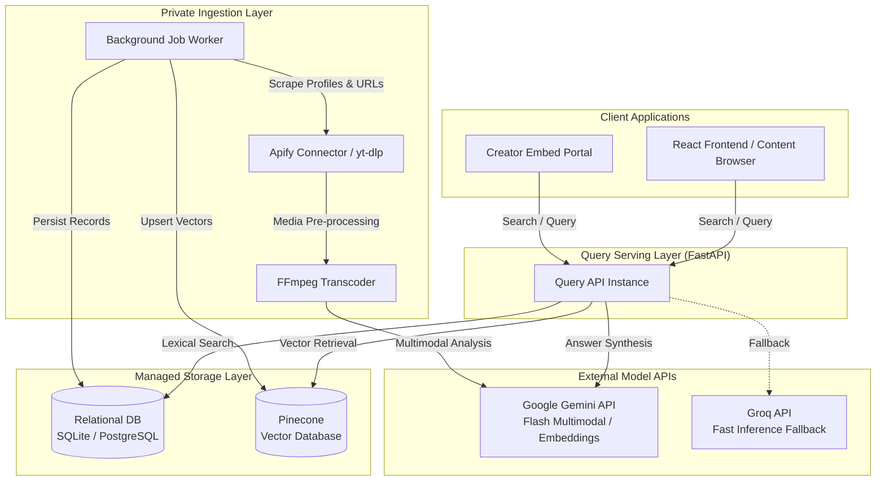

# CreatorRAG Architecture: Decoupled Ingestion and Query Serving

CreatorRAG is designed around a decoupled architecture inspired by the Command and Query Responsibility Segregation (CQRS) pattern. High-throughput ingestion, media downloading, and multimodal LLM parsing run on worker nodes, while lightweight vector retrieval and conversational answer synthesis execute on public, low-latency API instances.

---

## 1. System Architecture

---

## 2. Component Responsibilities

### Ingestion Node (Worker)
- Executes asynchronous background jobs dispatched via `POST /jobs/*` or `POST /libraries/{id}/sources`.
- Interfaces with social media extractors (Apify social actors, `yt-dlp`).
- Transcodes video files with FFmpeg, enforcing resolution caps (e.g., 720p maximum) to optimize API upload bandwidth.
- Dispatches media files to the Gemini Files API for multimodal audio and visual analysis.
- Generates text embeddings and upserts vectors directly into Pinecone.
- Persists relational post, source, and chunk records into SQLite/PostgreSQL.

### Query Serving Node (API)
- Exposes stateless HTTP endpoints for clients.
- Performs dual-branch hybrid retrieval:
  - Vector similarity query via Pinecone with explicit `library_id` metadata filtering.
  - Lexical full-text match via SQLite FTS5 (`chunks_fts`) scoped to the active library.
- Formulates grounded prompts and streams or returns structured conversational responses.
- Annotates responses with structured citation metadata (`[Source N]`).

### Storage and Hosting Strategy
- **Media Hosting Elimination:** Raw MP4 video files are discarded immediately after analysis unless `keep_media=true` is explicitly requested. The frontend client renders native platform iframes (Instagram embed widgets, TikTok embeds) using canonical post URLs, eliminating cloud object storage costs for video assets.
- **Data Boundary Isolation:** All relational queries and vector lookups require a `library_id` scope, guaranteeing multi-tenant isolation with zero cross-library contamination.

---

## 3. Product Operating Modes

### Personal Knowledge Base
Users create custom libraries (e.g., "Strength Training", "Gourmet Cooking"), ingest favorite reels or channels, and query the consolidated knowledge base via conversational chat.

### Creator Hub
A dedicated read-only portal for content creators:
- Restricted to a single, verified creator library.
- Offers semantic feed search: queries return ranked vertical video cards driven by semantic vector similarity rather than text synthesis alone.

---

## 4. Reliability and Resilience

- **Model Fallback Routing:** If a primary Gemini model encounters rate limits (HTTP 429) or temporary outages, the client automatically rotates across configured API keys and falls back through compatible model variants (`gemini-3.5-flash`, `gemini-3.5-flash-lite`, `gemini-3.8-flash`, etc.).
- **Graceful Degradation:** If Pinecone connectivity is interrupted, the engine falls back to local SQLite FTS5 lexical matching, ensuring continued query availability.
- **Idempotent Ingestion:** Re-running ingest on previously processed URLs utilizes content hashing (`content_hash`) and platform shortcodes to update existing records rather than producing duplicates.
