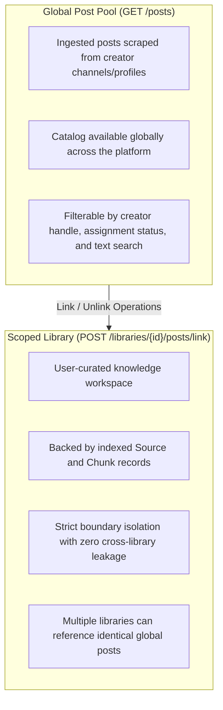

# Content Management Architecture

Content management governs the lifecycle and partition of content between the **Global Post Pool** (all ingested social media posts) and **User Libraries** (scoped RAG workspaces curated by users).

---

## 1. System Model: Global Pool vs. Scoped Libraries



---

## 2. Recommended UX Pattern: Content Browser

The Content Browser pattern operates similarly to digital asset management interfaces (e.g., Lightroom, Google Photos):

1. **Browse Global Pool:** The client requests `GET /posts` with search and creator filters.
2. **Select Posts:** Users multi-select posts via checkboxes.
3. **Link to Library:** Client sends `POST /libraries/{library_id}/posts/link` with the list of selected `post_ids`.
4. **Remove from Library (Bulk):** Client sends `DELETE /libraries/{library_id}/posts/bulk` to remove items without deleting them from the global pool.
5. **Batch Ingest Profile:** Client can link an entire creator catalog using `POST /libraries/{library_id}/profiles/{username}/link`.

---

## 3. Post Topic Titles (`title`)

Every post record maintains a concise topic title (`title`, <= 8 words) summarizing the core subject matter:

### Derivation Hierarchy
1. **Primary Origin (Zero Additional LLM Calls):** Extracted deterministically from the `## Topic` section produced during the initial multimodal video analysis (`r"##\s*Topic\s*\n([^\n#]+)"`).
2. **Fallback 1:** For caption-only posts lacking a `## Topic` block, a lightweight LLM call (`generate_title_from_caption`) generates an accurate summary title.
3. **Fallback 2:** The first non-empty line of the post caption.

### Performance and Ingestion Impact
- Deriving from `## Topic` eliminates duplicate LLM latency and token costs during ingestion.
- The derived title is assigned automatically in `prepare_post_index()` and preserved in SQLite `posts.title`, `sources.title`, and Pinecone vector metadata.

---

## 4. Endpoints Specification

### 4.1 Browse Global Posts

`GET /posts`

Query Parameters:

| Parameter | Type | Default | Description |
|---|---|---|---|
| `page` | integer | 1 | Page number. |
| `page_size` | integer | 50 | Items per page (maximum 200). |
| `creator` | string | null | Filter by `@creator_username`. |
| `library_id` | string | null | Filter by associated library ID or slug. |
| `unlinked_only` | boolean | false | Return only posts not assigned to any library. |
| `query` | string | null | Full-text query on captions and extracted knowledge. |

Response Payload:
```json
{
  "items": [
    {
      "id": "bejaranofit_ABC123",
      "url": "https://www.instagram.com/reel/ABC123/",
      "creator_username": "bejaranofit",
      "type": "Reel",
      "title": "Effective Squat Depth and Foot Placement",
      "description": "...",
      "extracted_knowledge": "...",
      "indexed_at": 1728000000.0,
      "library_id": "4ed2bd51-a4c6-41df-afac-25d28addf980"
    }
  ],
  "total": 336,
  "page": 1,
  "page_size": 50
}
```

---

### 4.2 Link Posts to Library

`POST /libraries/{library_id}/posts/link`

Request Body:
```json
{
  "post_ids": ["bejaranofit_ABC123", "bejaranofit_DEF456"]
}
```

Behavior:
- Verifies post records exist in the global catalog.
- Concurrently backfills titles if any posts lack one.
- Generates corresponding `Source`, `LibrarySource`, and `Chunk` records.
- Synchronizes the SQLite FTS5 lexical table (`chunks_fts`).
- Invalidates in-memory lexical caches.

Response Payload:
```json
{
  "status": "success",
  "message": "Linked 2 posts to library."
}
```

---

### 4.3 Link Entire Creator Catalog

`POST /libraries/{library_id}/profiles/{username}/link`

Links all posts matching the specified `creator_username` to the target library.

Response Payload:
```json
{
  "status": "success",
  "message": "Linked 215 posts to library."
}
```

---

### 4.4 Bulk Remove Posts from Library

`DELETE /libraries/{library_id}/posts/bulk`

Request Body:
```json
{
  "post_ids": ["bejaranofit_ABC123", "bejaranofit_DEF456"]
}
```

Behavior:
- Removes associations, `Source`, `Chunk`, and `chunks_fts` records within the target library.
- Preserves the base `Post` entity in the global pool.
- Deletes associated vectors from Pinecone.

Response Payload:
```json
{
  "status": "success",
  "removed": 2,
  "not_found": []
}
```

---

### 4.5 Remove Single Post from Library

`DELETE /libraries/{library_id}/posts/{post_id}`

Status: `200 OK`
```json
{
  "deleted": "bejaranofit_ABC123"
}
```
