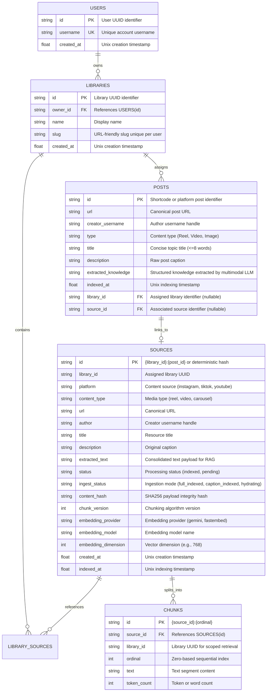

# Database Schema and Storage Architecture

CreatorRAG employs a hybrid storage layer consisting of a relational database (SQLite in local environments, compatible with PostgreSQL via SQLAlchemy ORM) for relational metadata and full-text search, alongside a managed vector database (Pinecone) for dense semantic retrieval.

---

## 1. Entity-Relationship Model



---

## 2. Full-Text Search Virtual Table (`chunks_fts`)

In SQLite deployments, lexical search is powered by an FTS5 virtual table synchronized with the `chunks` table:

```sql
CREATE VIRTUAL TABLE IF NOT EXISTS chunks_fts USING fts5(
    chunk_id UNINDEXED,
    library_id,
    text,
    tokenize='unicode61'
);
```

### Scoped Lexical Retrieval Query

To maintain strict boundary isolation between libraries, lexical matching is constrained by `library_id`:

```sql
SELECT c.chunk_id, c.text, bm25(chunks_fts) AS rank
FROM chunks_fts c
WHERE chunks_fts MATCH :query AND library_id = :library_id
ORDER BY rank
LIMIT :top_k;
```

---

## 3. Pinecone Vector Metadata Specification

Vectors stored within Pinecone represent individual textual chunks or consolidated posts. The metadata payload attached to each vector follows the specification below:

| Field | Type | Description |
|---|---|---|
| `library_id` | `string` | Primary multi-tenancy filter key. Queried via `$eq: library_id`. |
| `post_id` | `string` | Unique identifier or platform shortcode. |
| `source_id` | `string` | SQL relational source record identifier. |
| `creator_username` | `string` | Creator handle (e.g., `bejaranofit`). |
| `url` | `string` | Web URL used to render native embeds or iframes. |
| `title` | `string` | Post topic title derived from `## Topic`. |
| `caption` | `string` | Raw social media post caption text. |
| `extracted_knowledge` | `string` | Multimodal facts extracted from the media file. |
| `ingest_status` | `string` | Status indicator: `full_indexed` or `caption_indexed`. |
| `chunk_index` | `integer` | Ordinal position within the source chunk set. |

---

## 4. Production Database Location and Migrations

The production database is located at `C:\Users\sierr\.crag\crag.db` (or as overridden by the `CRAG_DB_PATH` environment variable).

### Migration Principles
- Database schemas are managed without destructive wipes.
- Incremental column additions are executed via idempotent `ALTER TABLE ADD COLUMN` statements.
- `storage.db.init_db()` ensures all newly declared SQLAlchemy models are created on startup via `Base.metadata.create_all(bind=engine)`.
