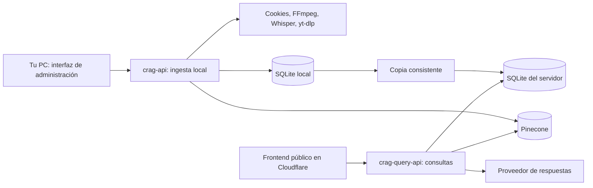

# Despliegue: ingesta local y consultas públicas

Revisión de arquitectura: 24 de octubre de 2026. Los dos servicios se ejecutan por separado; todavía no se ha publicado ninguno desde esta revisión.



## Qué servicio ejecutar

| Servicio | Comando | Acceso | Función |
| --- | --- | --- | --- |
| Ingesta y administración | `uv run --extra api --extra ingest crag-api` | Solo tu PC | Cookies, perfiles, descargas, análisis, bibliotecas y trabajos |
| Consultas | `uv run --extra api crag-query-api` | Servidor con HTTPS | Bibliotecas del usuario, fuentes y respuestas con citas |

La aplicación pública es `src.api.public:app`. No importa la aplicación de administración ni su gestor de trabajos. No publica `/config`, `/jobs`, `/users`, `/posts` ni `/media`; tampoco permite crear o borrar bibliotecas. Las consultas públicas fuerzan `allow_hydration=False`: todo análisis pendiente se completa primero en la ingesta.

Las dos imágenes de Docker se construyen con `--target ingest` y `--target query`. Solo la primera instala FFmpeg, Apify, Whisper y yt-dlp. Las versiones Python se conservan en `uv.lock`. El proveedor de embeddings debe seguir siendo el mismo que creó el índice: cambiarlo exige reindexar con un índice compatible.

## Opción inicial recomendada

Para un grupo pequeño y contenido que actualizas tú: frontend estático en Cloudflare Pages o Workers Static Assets y API Python en un contenedor con disco persistente. Puedes mantener Cloudflare como DNS, TLS y protección del tráfico. La ingesta sigue en tu PC y funciona aunque no hayas abierto acceso entrante a tu red.

Cloudflare soporta FastAPI en Python Workers, pero ese runtime no equivale a un servidor Linux con todas las dependencias nativas. Este proyecto usa SQLAlchemy y FastEmbed/ONNX, además de las herramientas de vídeo de la ingesta; no se ha comprobado su compatibilidad como Worker. Un contenedor conserva el runtime actual. [Paquetes de Python Workers](https://developers.cloudflare.com/workers/languages/python/packages/).

Si quieres alojar también Python dentro de Cloudflare, Containers admite runtimes y bibliotecas que requieren un sistema de archivos completo, y requiere Workers Paid. Tiene más configuración que publicar una SPA; debe validarse con una prueba real de imagen, almacenamiento, arranque y conexión a Pinecone antes de elegirlo. [Cloudflare Containers](https://developers.cloudflare.com/containers/), [frontend estático y backend en contenedor](https://developers.cloudflare.com/containers/examples/container-backend/).

No hace falta alquilar una GPU para las consultas. Con `fastembed`, la CPU y memoria del servidor cargan el modelo ONNX de embeddings; la generación de respuestas se realiza en el proveedor configurado. La ingesta puede usar tu GPU para Whisper y tus recursos locales para FFmpeg. Si más adelante necesitas ingesta permanente, el mismo contenedor de ingesta puede correr en una máquina dedicada, con secretos y almacenamiento separados.

## Preparar acceso de un grupo cerrado

1. Crea los usuarios y bibliotecas en la ingesta. `uv run --extra ingest crag user list` muestra los UUID existentes.
2. Genera una clave aleatoria distinta por persona. No uses contraseñas elegidas por usuarios: el mecanismo actual es una clave de acceso de alta entropía para un grupo cerrado.
3. Configura en el servidor el SHA-256 de cada clave asociado a su UUID. Entrega la clave original a su destinatario por un canal privado. El servidor conserva el digest, no la clave.

Ejemplo de generación local, ejecutado por el administrador:

```bash
python -c "import secrets,hashlib; token=secrets.token_urlsafe(32); print('Clave:',token); print('Digest:',hashlib.sha256(token.encode()).hexdigest())"
```

Configura `CRAG_PUBLIC_TOKEN_USERS` como JSON, por ejemplo `{"digest_hexadecimal_de_64_caracteres":"UUID_del_usuario"}`. Una configuración vacía o mal formada impide arrancar el servicio. Para revocar una clave, elimina su digest y reinicia el servicio. Para rotarla, reemplázala por un digest nuevo.

La identidad se deriva de `Authorization: Bearer ...`; el servicio público ignora `X-User-Id` y cualquier `user_id` enviado en el cuerpo. No hay registro público, recuperación de contraseñas ni MFA propios. Para ofrecer registro abierto, sustituye este acceso por un proveedor de identidad con sesiones verificadas antes de abrirlo a desconocidos.

## Base de datos y actualización del contenido

### Empezar con SQLite

La API pública necesita una copia de la base SQL además del índice Pinecone. Pinecone por sí solo no contiene toda la información de usuarios, bibliotecas y permisos.

1. Espera a que termine la ingesta y comprueba sus resultados.
2. Crea una copia consistente sin modificar el original:

```bash
python scripts/snapshot_database.py /ruta/a/crag.db /ruta/nueva/publicacion.db
```

La herramienta usa SQLite Backup y comprueba la integridad. Rechaza destinos existentes. La base predeterminada suele estar en `~/.crag/crag.db`, salvo `CRAG_CONFIG_DIR` o `CRAG_DATABASE_URL` explícitos.

3. Transfiere esa copia por un canal privado al servidor. Nunca publiques el fichero SQL como recurso estático. No transfieras cookies, descargas ni el `.env` de ingesta.
4. Detén la API de consultas, conserva una copia del fichero anterior, instala la nueva base en su volumen persistente y arráncala otra vez. No reemplaces una base SQLite abierta por procesos activos.
5. Comprueba `/health` y realiza una consulta autenticada contra una biblioteca propia. `/health` solo confirma que el proceso responde; no valida Pinecone ni el proveedor LLM.

Esta opción publica actualizaciones mediante copias; no sincroniza automáticamente la ingesta con internet. Los UUID de usuarios y bibliotecas deben mantenerse. Una copia SQL y un índice Pinecone compartido tampoco constituyen una transacción distribuida: evita cambiar el índice mientras validas una publicación o un rollback.

### Cuando necesites actualizaciones inmediatas

Usa una base PostgreSQL compartida: la ingesta escribe y la API pública consulta. Este repositorio ya tiene rutas SQL para PostgreSQL, pero esta revisión no ha migrado datos ni probado un servidor PostgreSQL. Antes de usarlo hay que elegir proveedor, añadir y bloquear el controlador correspondiente, ejecutar y revisar migraciones, validar la búsqueda de texto, configurar TLS, copias de seguridad y permisos distintos para cada servicio. No basta con cambiar la URL de SQLite.

El servicio público no debe tener credenciales de administración de la base ni secretos de Apify o cookies. Los permisos mínimos exactos deben validarse con las operaciones reales del motor RAG.

## Frontend público

Usa `frontend/.env.query.example` como referencia para la configuración de compilación:

```ini
VITE_APP_MODE=query
VITE_API_URL=https://api.tu-dominio.com
```

En Cloudflare: directorio raíz `frontend`, comando `npm ci && npm run build`, salida `dist`. Esta variante muestra acceso, selección de biblioteca, chat y fuentes. La variante predeterminada continúa siendo la administración local. [Guías de frameworks de Pages](https://developers.cloudflare.com/pages/framework-guides/).

Nunca configures claves de proveedores o claves de acceso de usuarios en `VITE_*`. El visitante introduce su clave al entrar; se mantiene en memoria y se borra al cerrar sesión o recargar. Los chats públicos tampoco se guardan en `localStorage`. Autoriza el origen exacto del frontend mediante `CRAG_CORS_ORIGINS`.

## Contenedor de consultas

```bash
cp deployment/.env.query.example deployment/.env.query
# Completa los secretos y carga la base de datos antes de usar el servicio.
docker compose -f deployment/compose.query.yml build
docker compose -f deployment/compose.query.yml up -d
```

El puerto de ejemplo se publica únicamente en `127.0.0.1:8001`. Añade un proxy HTTPS o un túnel dirigido exclusivamente al servicio de consultas. Configura correctamente el volumen `query-state` con la copia SQL y propietario UID 10001. Este archivo no instala TLS ni publica un dominio por sí mismo.

No publiques el `docker-compose.yml` de desarrollo ni un túnel hacia `crag-api`. La ingesta debe permanecer accesible solo desde tu PC. Configura `CRAG_HOST=127.0.0.1` para ejecución nativa y limita los orígenes del navegador.

## Límites y comprobaciones antes de abrir acceso

La API de consultas limita el cuerpo a 128 KiB, la pregunta a 8.000 caracteres, el historial a 12 turnos, la recuperación a 20 resultados y la concurrencia a 4 consultas por proceso. Permite 20 consultas por usuario por minuto. Devuelve 401 sin credencial válida, 404 para bibliotecas ajenas, 413 por tamaño, 429 por frecuencia, 503 por capacidad y 502 ante un fallo del proveedor sin exponer sus detalles al navegador.

Los límites de frecuencia y concurrencia viven en memoria y se reinician con el proceso. Empieza con una sola instancia/proceso. Para varias réplicas, añade un límite compartido o reglas de entrada apropiadas; los límites por proceso se multiplican. Añade protección de tráfico no autenticado en el proxy y un límite de gasto en los proveedores. Un timeout del navegador no cancela por sí solo una llamada síncrona ya iniciada en el servidor.

Comprueba con claves de dos usuarios distintos: bibliotecas propias y ajenas, contenido vacío, sesión revocada, proveedor sin cuota, reinicio y actualización de base. Verifica los embeds de Instagram/TikTok y su enlace alternativo: los proveedores pueden exigir login o bloquear la reproducción. El sandbox de los embeds restringe sus capacidades.

## Verificación realizada

| Comprobación | Resultado |
| --- | --- |
| Pruebas Python | 154 aprobadas; una advertencia de deprecación del SDK de Google |
| TypeScript, lint y compilación de administración | Comandos aprobados; lint conserva recomendaciones sobre efectos de carga y TanStack/React Compiler |
| Compilación del frontend público | Aprobada; los artefactos de prueba se guardaron fuera del directorio fuente |
| Lockfile Python | Validado con `uv lock --check --offline` |
| Dependencias de consultas | Exportación sin Apify, Whisper ni yt-dlp |
| Compose local y público | Configuración validada |
| Imagen `query` | Construida como `creatorrag-query:audit` |
| Arranque del contenedor sin red | Health HTTP, autenticación, bibliotecas y rechazo de rutas de administración comprobados con datos ficticios |
| Aislamiento del contenedor | Usuario sin privilegios; FFmpeg y los paquetes de ingesta ausentes |

El acceso a proveedores reales, la construcción de la imagen de ingesta en el entorno de destino, la migración PostgreSQL y la comprobación visual en navegador siguen pendientes. El navegador rechazó el permiso de observación durante la revisión; no se sustituyó esa comprobación por una afirmación de funcionamiento visual. No se ha publicado ningún servicio ni cambiado credenciales reales.
